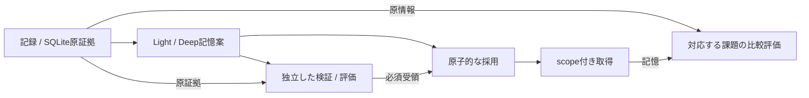

# agent-sleep-lab

[English](README.md) | **日本語**

AIエージェントの経験を根拠付きの**外部記憶**に整理し、原情報のみの場合と原情報＋記憶の場合を比較する実験用ハーネスです。モデルの重み学習でも、参考にしたシステムの公式実装でもありません。

## クイックスタート

Python 3.11以上を用意し、ローカルのリポジトリで実行します。

```sh
python3 -m venv .venv
.venv/bin/python -m pip install .
.venv/bin/agent-sleep-lab demo
```

demoは組込みの合成fixture・台本応答・使い捨ての一時storeで動き、JSONを出力します。
データ・store・providerの指定は受け付けず、実モデルを呼びません。
[demo契約 →](docs/runtime-guide.ja.md#組込みオフラインdemo)

## アーキテクチャ

合成データ用ランタイムの概念図です。各段階は明示的に呼び出すもので、
自動実行や本番agent接続を示すものではありません。



実行時の正本はSQLite、JSON／Markdownは入出力形式です。
providerは記憶案を生成しますが、検証受領や実行権限は発行しません。
[構成要素と別経路の公開文書lifecycle →](docs/architecture-overview.ja.md)

## 調べる

| 知りたいこと | 入口 |
|---|---|
| 現在の能力・検証結果・残る課題 | [実装状況](docs/implementation-status.ja.md) — 現在地の唯一の正本 |
| コマンドと実行条件 | [ランタイム手順](docs/runtime-guide.ja.md) |
| 公開文書1件の受入・review・再利用・削除 | [公開文書lifecycle](docs/public-document-lifecycle.ja.md) — 別のlibrary／store |
| 接続・評価・研究背景・開発時の確認 | [文書索引](docs/index.ja.md) |

## 境界

台本demoの成績や手動下書きの受け渡しは、実agent接続や性能改善の証拠ではありません。
日付付き試用は試した版の記録で、現在の作業指示ではありません。
公開fixtureは合成データに限定し、私的会話・認証情報・記憶・評価の解答はrepoへ入れません。
有料推論には呼出し側の明示選択と上限が必要です。byte上限はtoken・金額の上限ではありません。

## ライセンス

package metadataは**UNLICENSED**です。オープンソースライセンスは付与していません。
[pyproject.toml](pyproject.toml)を参照してください。
