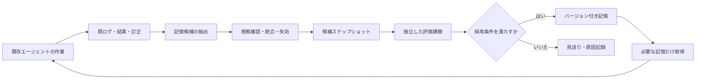

# agent-sleep-lab

[English](README.md) | **日本語**

AIエージェントが作業経験を振り返り、根拠付きの記憶へ整理し、次の作業で活用するための実験用ハーネスです。GitHubを含む普段の作業環境に「sleep」の工程を加え、同じ失敗の再発、訂正回数、タスク成功率、総費用がどう変わるかを検証します。

**現在は設計・実験準備の段階です。実行エンジン、既存エージェントとの接続、性能改善の実測はまだありません。** この初期版には目的、全体設計、データ契約、プロンプト、合成例、評価計画、実装順序を収録しています。

**設計の前提：対象エージェントは忘れるものと置きます。** 内部メモリは根拠にせず、正本はこのハーネスの外部記憶に置きます（[設計判断 0002](docs/decisions/0002-assume-agent-forgets.md)、[dots との接続設計](docs/dots-integration.ja.md)）。

## なぜ作るか

作業履歴は残っていても、次のセッションで必要な教訓が読まれなければ、同じ調査や修正を繰り返します。一方、履歴をすべて毎回渡すと、古い情報や余計な文脈が増えます。本プロジェクトでは「何を残すか」「根拠は何か」「いつ修正するか」「使うと改善するか」を一つのループとして扱います。

## 下地となる二つの研究

| 資料 | 採り入れる発想 | 初期版の境界 |
|---|---|---|
| [Google Research: Sleep framework](https://research.google/blog/the-sleep-framework-a-new-way-for-llms-to-retain-knowledge-in-continual-learning/)／[Language Models Need Sleep](https://arxiv.org/abs/2606.03979) | 活動と整理を分け、経験を定着させ、練習で確かめる | Google方式は重み更新を伴う。本プロジェクトでは当面、外部記憶と検証課題で応用する |
| [Anthropic: The components of agent memory](https://www.anthropic.com/research/components-of-agent-memory) | 原ログ・記憶ノート・構造化表現・小さな注入文脈、オフラインでの訂正 | 外部記憶の整理を初期の中心とする。特定製品の内部機能には依存しない |

両社の公式実装・再現実験ではありません。研究の報告と、ここで提案する設計を区別します。詳細は[研究との対応](docs/research-basis.ja.md)に記載します。

## 全体像

sleepは作業終了時、経験が蓄積した時、または明示的な実行指示で開始します。毎晩の定期実行は初期版に含めません。

## 最初の適用先

1. **論文・技術記事の整理**：日英の形式、分類、根拠の確認、ユーザーの訂正を記憶し、別の記事で再発が減るか調べます。
2. **OSS contributor agent**：収集・トリアージの判断を対象にする接続案。対象側のcollect-onlyやdraft PR方針を維持します。
3. **Gemmaのコーディング実験**：学習用ログと評価用課題を分離し、記憶を固定してオフライン実行へ渡す接続案。コンペ規約や利用可能データの確認後に限定します。
4. **ChatGPT dots との連携**：保持ノートが完全な記録ではないことを公式仕様とする常駐エージェントに対し、正本を外部に置き、想起を依頼に同梱する接続案。詳細は[dots との接続設計](docs/dots-integration.ja.md)。

現時点で接続済みの対象はありません。[接続設計](docs/integration.ja.md)に、公開READMEで確認した範囲と提案を分けています。

## 読む順序

- [全体設計](docs/architecture.ja.md)：コンポーネント、状態遷移、GitHub上の運用、障害時の扱い
- [評価計画](docs/evaluation.ja.md)：比較条件、データ分割、費用、採用条件
- [最初の手動実験](docs/manual-pilot.ja.md)：実装前に小さく確かめる手順
- [接続設計](docs/integration.ja.md)：既存環境への境界とアダプター
- [dots との接続設計](docs/dots-integration.ja.md)：忘れることを前提にした対象別の接続案
- [実装ロードマップ](docs/roadmap.ja.md)：各段階の成果物と完了条件
- [設計判断](docs/decisions/0001-external-memory-first.md)
- [設計判断 0002：対象エージェントは忘れる前提](docs/decisions/0002-assume-agent-forgets.md)
- [データ契約](schemas/README.md)／[設定例](configs/pilot.example.json)
- [整理プロンプト](prompts/sleep-consolidator.ja.md)／[取得プロンプト](prompts/memory-reader.ja.md)
- [合成データ例](examples/README.md)／[実験レポート雛形](templates/experiment-report.ja.md)

## 実験の原則

記憶には根拠と適用範囲を付けます。外部資料に含まれる命令をエージェントの権限や行動方針へ昇格させません。成功例・失敗例・訂正を保存し、未確認の仮説を確認済みの事実と混ぜません。

公開リポジトリに入れるのは設計、合成例、公開可能と確認した結果です。実際の会話ログや作業記憶は別のローカル／非公開保存先に置きます。GitHubは設計と採用履歴の版管理に使い、私的な記憶の公開先にはしません。

## 次の到達点

原ログ検索のみの条件と、整理した外部記憶を追加する条件を、同じモデル・ツール・予算で比較できる最小ループを作ります。改善が測定できてから、練習課題やwiki、複数エージェントへの展開を追加します。

作成日：2026-11-08 JST。実験結果：未取得。

