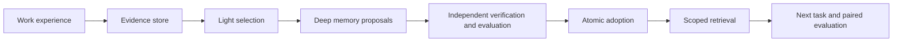

# agent-sleep-lab

**English** | [日本語](README.ja.md)

An experimental harness for turning an AI agent's work experience into grounded external memories, then evaluating whether those memories help its next task. It separates capture, Light/Deep consolidation, independent verification, atomic adoption, retrieval and paired evaluation. This is **external memory**, not model-weight training.

## Why

Keeping a transcript is not the same as learning from it. This project studies what to retain, which evidence supports it, when to revise it and whether reuse improves outcomes and total cost. A source document or generated memory never grants execution permission.

## Current development

[Implementation status](docs/implementation-status.md) is the single authority for current capabilities, progress, merge state and verification evidence. Gate reports are dated history, not current operating instructions. Start with the [runtime guide](docs/runtime-guide.md) for explicit sleep, adoption, retrieval and comparison commands.

For existing adopted synthetic memories, use the explicit read-only [OSS request preparation](docs/oss-prepare.md) command. It constructs paired inputs offline, without sending them.

For a built-in synthetic offline walkthrough, run:

```sh
agent-sleep-lab demo
```

It takes no data, store or provider options, uses disposable temporary state and
prints a JSON report. The [demo contract](docs/runtime-guide.md#built-in-offline-demo)
explains fixture receipts, frozen raw/memory arms, bounds and answer separation.
Verification evidence belongs in [implementation status](docs/implementation-status.md).

The [synthetic fixture cohort contract](docs/oss-fixture-cohort.md) describes predeclared multi-task accounting; it is not a live-model or independent holdout evaluation.
The [selected-issue offline probe contract](docs/oss-selected-issue-probe.md) defines explicit issue selection and forced-judge provenance alongside the default v1 route.

The initial-version target is capture → adoption → retrieval → Light/Deep → comparative evaluation → one existing-agent integration. REM, diary, schedules and wider rollout are optional later work. A manual draft handoff is not a connected agent, and fake-provider scores are not evidence of model improvement.

## Architecture



Only synthetic fixtures belong in this public repository. Real transcripts, credentials, private memories and evaluator answer keys belong in private runtime storage. SQLite is the runtime source of truth; JSON/Markdown are interchange artifacts, not a replacement for transactional adoption.

## Reading order

- [Architecture](docs/architecture.ja.md) and [contracts / acceptance](docs/contracts-and-acceptance.md)
- [Runtime guide](docs/runtime-guide.md) and [schemas](schemas/README.md)
- [Evaluation design](docs/evaluation.ja.md) and [roadmap](docs/roadmap.ja.md)
- [Research basis](docs/research-basis.ja.md), [Sleep / dreaming](docs/dreaming.ja.md), [external-memory decision](docs/decisions/0001-external-memory-first.md)
- [Integration boundaries](docs/integration.ja.md) and [forgetful-agent design](docs/dots-integration.ja.md)
- [Synthetic examples](examples/README.md) and [test policy](docs/testing-budget.ja.md)

The research basis includes Google's [Sleep framework](https://research.google/blog/the-sleep-framework-a-new-way-for-llms-to-retain-knowledge-in-continual-learning/), Anthropic's [components of agent memory](https://www.anthropic.com/research/components-of-agent-memory), and OpenClaw [Dreaming](https://docs.openclaw.ai/concepts/dreaming). This repository is not an official implementation or reproduction of those systems.

## Development checks

Python 3.11 or later. Install the project and run:

```sh
python -m pip install .
python tests/run_tests.py
python tools/check_docs.py
```

PR and main CI run the full unique regression set on Python 3.11 and 3.13, plus documentation file links and wheel build. CI never makes paid model calls. Explicit affected test names can be supplied to the runner while repairing a failure; imported fixture aliases are deduplicated by test ID.
