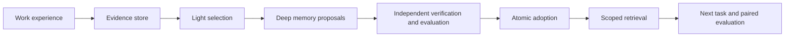

# agent-sleep-lab

**English** | [日本語](README.ja.md)

An experimental harness for turning an AI agent's work experience into grounded external memories, then evaluating whether those memories help its next task. It separates capture, Light/Deep consolidation, independent verification, atomic adoption, retrieval and paired evaluation. This is **external memory**, not model-weight training.

## Start here

| Goal | Read |
|---|---|
| Understand what is implemented, merged and verified | [Implementation status](docs/implementation-status.md) |
| Try the built-in offline walkthrough | [Quick start](#quick-start) |
| Run explicit sleep, adoption, retrieval or comparison commands | [Runtime guide](docs/runtime-guide.md) |
| Read the dated public-information trial | [2026-11-12 trial report](docs/public-source-trial-2026-11-12.md) |

Implementation status is the single authority for current capabilities and verification.
Dated reports describe the tested version, not current operating instructions.
The public-information report records a **separate local, unmerged extension**;
the report's publication does not add that runtime path to this repository.

## Quick start

Python 3.11 or later, from a local repository checkout:

```sh
python3 -m venv .venv
.venv/bin/python -m pip install .
.venv/bin/agent-sleep-lab demo
```

The demo uses only built-in synthetic fixtures and scripted responses. It accepts
no data, store or provider options, creates disposable temporary state and prints
a JSON report. It does not call a live model or ingest your work history.
See the [demo contract](docs/runtime-guide.md#built-in-offline-demo) for fixture
receipts, frozen raw/memory arms, bounds and answer separation.

## Why and how

Keeping a transcript is not the same as learning from it. This project studies
what to retain, which evidence supports it, when to revise it and whether reuse
improves outcomes and total cost.



SQLite is the runtime source of truth. JSON/Markdown are interchange artifacts,
not a replacement for transactional adoption. A source document or generated
memory never grants execution permission.

The initial-version target is capture → adoption → retrieval → Light/Deep →
comparative evaluation → one existing-agent integration. REM, diary, schedules
and wider rollout are optional later work. A manual draft handoff is not a
connected agent, and fake-provider scores are not evidence of model improvement.

## Runtime and evaluation guides

- [Runtime guide](docs/runtime-guide.md): explicit commands and their conditions.
- [OSS request preparation](docs/oss-prepare.md): read-only, offline paired-input
  construction from existing adopted synthetic memories; no sending.
- [Synthetic fixture cohort](docs/oss-fixture-cohort.md): predeclared multi-task
  accounting, not a live-model or independent holdout evaluation.
- [Selected-issue offline probe](docs/oss-selected-issue-probe.md): explicit issue
  selection and forced-judge provenance, separate from the default v1 route.

Public repository fixtures must remain synthetic. Real transcripts, credentials,
private memories and evaluator answer keys belong in private runtime storage.
A published, non-sensitive trial summary does not authorize publishing its inputs
or outputs, or feeding real data into synthetic-only interfaces.

## Design and background

- [Architecture](docs/architecture.ja.md) and [contracts / acceptance](docs/contracts-and-acceptance.md)
- [Schemas](schemas/README.md), [synthetic examples](examples/README.md) and [test policy](docs/testing-budget.ja.md)
- [Evaluation design](docs/evaluation.ja.md) and [roadmap](docs/roadmap.ja.md)
- [Research basis](docs/research-basis.ja.md), [Sleep / dreaming](docs/dreaming.ja.md), [external-memory decision](docs/decisions/0001-external-memory-first.md)
- [Integration boundaries](docs/integration.ja.md) and [forgetful-agent design](docs/dots-integration.ja.md)

The research basis includes Google's [Sleep framework](https://research.google/blog/the-sleep-framework-a-new-way-for-llms-to-retain-knowledge-in-continual-learning/), Anthropic's [components of agent memory](https://www.anthropic.com/research/components-of-agent-memory), and OpenClaw [Dreaming](https://docs.openclaw.ai/concepts/dreaming). This repository is not an official implementation or reproduction of those systems.

## Development checks

After installation:

```sh
.venv/bin/python tests/run_tests.py
.venv/bin/python tools/check_docs.py
```

PR and main CI run the full unique regression set on Python 3.11 and 3.13, plus
documentation file links and wheel build. CI never makes paid model calls.
Explicit affected test names can be supplied during repair; imported fixture
aliases are deduplicated by test ID.
