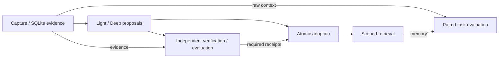

# agent-sleep-lab

**English** | [日本語](README.ja.md)

An experimental harness that turns an AI agent's experience into evidence-grounded **external memory**, then compares raw context against raw context plus memory. This is not model-weight training or an official implementation of the systems that inspired it.

## Quick start

Python 3.11+, from a local repository checkout:

```sh
python3 -m venv .venv
.venv/bin/python -m pip install .
.venv/bin/agent-sleep-lab demo
```

The demo uses built-in synthetic fixtures, scripted responses and disposable
temporary stores; it prints JSON. It accepts no data, store or provider options
and makes no live-model calls. [Demo contract →](docs/runtime-guide.md#built-in-offline-demo)

## Architecture

Conceptual flow of the synthetic runtime; each stage requires explicit invocation,
not an automatic or deployed agent loop.



SQLite is the runtime source of truth; JSON/Markdown are interchange artifacts.
Providers propose memories, not verification receipts or execution permissions.
[Component map and separate public-document path →](docs/architecture-overview.md)

## Explore

| Looking for… | Start here |
|---|---|
| Current capabilities, verification and open gaps | [Implementation status](docs/implementation-status.md) — the sole current-status authority |
| Commands and their execution conditions | [Runtime guide](docs/runtime-guide.md) |
| One-document admission, review, reuse and deletion | [Public-document lifecycle](docs/public-document-lifecycle.md) — a separate library/store |
| Integration, evaluation, research or development checks | [Documentation index](docs/index.md) |

## Boundaries

Scripted demo scores and manual draft handoffs are not live-agent integration or
proof of improvement. Dated trials describe their tested versions, not current
instructions. Public fixtures stay synthetic; private transcripts, credentials,
memories and evaluator answers stay out of the repository. Paid inference needs
an explicit bounded caller choice; byte limits are not token or monetary caps.

## License

Package metadata is **UNLICENSED**; no open-source license is granted.
See [pyproject.toml](pyproject.toml).
