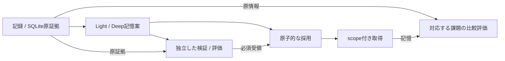
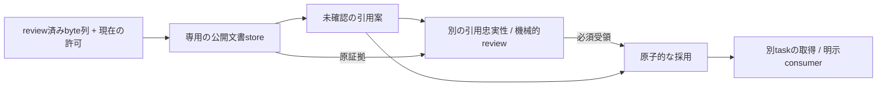

# 構成の概要

[English](architecture-overview.md) | **日本語** | [文書索引](index.ja.md) | [ホーム](../README.ja.md)

本書はsource moduleと境界の対応図であり、本番導入や実モデルでの受入完了を示しません。
検証と残る課題は[実装状況](implementation-status.ja.md)、明示コマンドは
[ランタイム手順](runtime-guide.ja.md)、広い提案は[全体設計](architecture.ja.md)を参照してください。

## 合成データ用ランタイム：記憶案と採用済み記憶は別

- Captureは原byte列と来歴を記録し、Lightは証拠を選び、Deepは変更を提案します。
  生成案は未確認候補であり、確認済みの事実にはなりません。
- 呼出し側が正確な候補artifactと、検証／snapshot評価の受領を別途準備します。
  providerは受領を発行できません。ローカルの役割分離は本番認証や独立した科学評価ではありません。
- 原子的なwriterは期待親版・正確なartifact・受領・現在のpolicy／除外を照合し、
  snapshotとjournalを一緒にcommitします。
- 取得はscopeとbyte予算の範囲で適格な採用済みrecordを返します。
  参考文はデータであり、書かれた内容を実行する権限にはなりません。
- 対応比較はcontextを固定し、Aに原情報、Bに同じ原情報prefix＋記憶を渡します。
  課題応答と別の採点は分離し、解答は課題providerのrequestに含めません。
  byte増加や台本の点数は、実費削減や一般的な性能改善の証拠ではありません。

### 責務とsourceの対応

以下のsourceはすべて`src/agent_sleep_lab/`内です。

| 責務 | Source |
|---|---|
| 明示CLIの振分けと実行artifact | [cli.py](../src/agent_sleep_lab/cli.py)、[runtime_cli.py](../src/agent_sleep_lab/runtime_cli.py)、[runtime_artifacts.py](../src/agent_sleep_lab/runtime_artifacts.py) |
| 記録・正確な原byte列・来歴 | [evidence_store.py](../src/agent_sleep_lab/evidence_store.py)、[provenance.py](../src/agent_sleep_lab/provenance.py) |
| 上限付きLight／Deep、checkpoint、未確認候補 | [sleep_coordinator.py](../src/agent_sleep_lab/sleep_coordinator.py)、[sleep_candidates.py](../src/agent_sleep_lab/sleep_candidates.py) |
| 検証／評価受領の登録とtransaction採用 | [runtime_store.py](../src/agent_sleep_lab/runtime_store.py)、[adoption_store.py](../src/agent_sleep_lab/adoption_store.py) |
| scope付き記憶取得と原情報baseline | [retrieval.py](../src/agent_sleep_lab/retrieval.py)、[raw_baseline.py](../src/agent_sleep_lab/raw_baseline.py) |
| 固定比較plan・実行journal・保存結果の検査 | [ab_comparison.py](../src/agent_sleep_lab/ab_comparison.py)、[comparison_prepare.py](../src/agent_sleep_lab/comparison_prepare.py)、[comparison_inspect.py](../src/agent_sleep_lab/comparison_inspect.py) |
| 組込み台本demo／明示選択するMiMo adapter | [offline_demo.py](../src/agent_sleep_lab/offline_demo.py)／[mimo_provider.py](../src/agent_sleep_lab/mimo_provider.py) |

証拠・policy・受領・snapshot・journalの正本はSQLiteです。JSON／JSONL／Markdownは
入出力や報告用artifactであり、原子的なwriterの代わりにはなりません。demoは一時的な
合成storeを使い、私的な実行データは公開repoへcommitしません。

## 別の公開文書1件library

この経路は、上記の合成storeへ公開データを受け入れるものではありません。
[public_source_intake.py](../src/agent_sleep_lab/public_source_intake.py)はreview済みの
正確な公開byte列を準備し、[public_document_runtime.py](../src/agent_sleep_lab/public_document_runtime.py)は
別々に設定した役割を持つ、専用の版付きSQLite libraryを提供します。

引用の忠実性と機械的snapshot検査は、抽象化の品質や有用性を保証しません。
consumer呼出しはhost側の別の明示選択です。入口へ入る前にunknown intentを永続化し、
実入力の観測・返却結果・別の意味reviewを異なる記録として扱います。暗黙のfetch、
モデル呼出し、CLI自動dispatch、timer、公開許可はありません。

内容へのアクセスは現在の許可・期限・除外で制御します。管理byte列の削除は、remote複製・
任意export・backup・停止中プログラムのcleanupを保証しません。受入、no-retry identity、
削除保証と制限は[lifecycle契約](public-document-lifecycle.ja.md)を参照してください。
これは実agent接続や性能受入の完了を示すものではありません。

## この図の外側

[実装契約](contracts-and-acceptance.ja.md)が採用・rollback・論理忘却を定義します。
[OSSリクエスト準備](oss-prepare.ja.md)は送信せずofflineで入力を作ります。
REM・日記・定期処理・広い接続は[設計／ロードマップ](index.ja.md#設計と評価)の項目であり、
暗黙の常駐serviceではありません。
