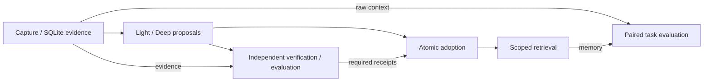
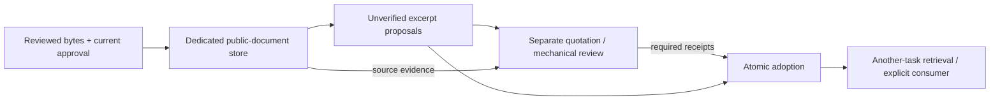

# Architecture overview

**English** | [日本語](architecture-overview.ja.md) | [Documentation](index.md) | [Home](../README.md)

This is a source-module and boundary map, not a deployment or live-acceptance
claim. See [implementation status](implementation-status.md) for verification
and open gaps, [runtime guide](runtime-guide.md) for explicit commands and
[detailed design (日本語)](architecture.ja.md) for broader proposals.

## Synthetic runtime: proposals are not adopted memories

- Capture records source bytes and provenance; Light selects evidence and Deep
  proposes changes. Generated proposals remain pending, not verified facts.
- The caller separately prepares exact candidate artifacts and verification /
  snapshot-evaluation receipts. Providers cannot issue those receipts. Local role
  separation is not production authentication or independent scientific review.
- The atomic writer checks the expected parent, exact artifacts, receipts and
  current policy/exclusions before committing the snapshot and journal together.
- Retrieval returns eligible adopted records within scope and a byte budget.
  Reference text is data, never permission to execute its contents.
- Paired evaluation freezes context: A receives raw context; B receives that same
  raw prefix plus memory. Task responses and separate scoring remain distinct;
  the answer key stays outside task-provider requests. A byte increase or scripted
  score is not measured cost savings or general performance evidence.

### Where the responsibilities live

All source links below are under `src/agent_sleep_lab/`.

| Responsibility | Source |
|---|---|
| Explicit CLI routing and runtime artifacts | [cli.py](../src/agent_sleep_lab/cli.py), [runtime_cli.py](../src/agent_sleep_lab/runtime_cli.py), [runtime_artifacts.py](../src/agent_sleep_lab/runtime_artifacts.py) |
| Capture, exact-byte evidence and provenance | [evidence_store.py](../src/agent_sleep_lab/evidence_store.py), [provenance.py](../src/agent_sleep_lab/provenance.py) |
| Bounded Light/Deep stages, checkpoints and pending candidates | [sleep_coordinator.py](../src/agent_sleep_lab/sleep_coordinator.py), [sleep_candidates.py](../src/agent_sleep_lab/sleep_candidates.py) |
| Verification/evaluation receipt registration and transactional adoption | [runtime_store.py](../src/agent_sleep_lab/runtime_store.py), [adoption_store.py](../src/agent_sleep_lab/adoption_store.py) |
| Scoped memory retrieval and raw-context baseline | [retrieval.py](../src/agent_sleep_lab/retrieval.py), [raw_baseline.py](../src/agent_sleep_lab/raw_baseline.py) |
| Frozen paired plan, execution journal and saved-outcome inspection | [ab_comparison.py](../src/agent_sleep_lab/ab_comparison.py), [comparison_prepare.py](../src/agent_sleep_lab/comparison_prepare.py), [comparison_inspect.py](../src/agent_sleep_lab/comparison_inspect.py) |
| Built-in scripted walkthrough / explicitly selected MiMo adapter | [offline_demo.py](../src/agent_sleep_lab/offline_demo.py) / [mimo_provider.py](../src/agent_sleep_lab/mimo_provider.py) |

SQLite is the source of truth for evidence, policy, receipts, snapshots and
journals. JSON/JSONL/Markdown are interchange or reporting artifacts, not an
alternative atomic writer. The demo uses temporary synthetic stores; private
runtime data must not be committed to the public repository.

## Separate one-document public-data library

This path does **not** admit public data into the synthetic stores above.
[public_source_intake.py](../src/agent_sleep_lab/public_source_intake.py) stages
exact reviewed public bytes; [public_document_runtime.py](../src/agent_sleep_lab/public_document_runtime.py)
provides a dedicated versioned SQLite library with separately configured roles.

Quotation fidelity and mechanical snapshot checks do not establish abstraction
quality or usefulness. Consumer dispatch is a separate explicit host choice:
unknown intent is durable before entry; input observation, returned result and
separate semantic review are different records. There is no implicit fetching,
model call, CLI auto-dispatch, timer or permission to publish.

Current control/expiry/exclusions gate content access. Managed-byte deletion does
not cover remote copies, arbitrary exports, backups or stopped-program cleanup.
See the [lifecycle contract](public-document-lifecycle.md) for admission, no-retry
identity, deletion guarantees and limitations. This is not a connected-agent or
performance-acceptance claim.

## Beyond this map

The [contracts](contracts-and-acceptance.md) define adoption, rollback and logical
forgetting. [OSS preparation](oss-prepare.md) builds offline inputs without sending
them. REM, diary, scheduling and wider integration belong to the
[design/roadmap](index.md#design-and-evaluation), not an implied background service.
