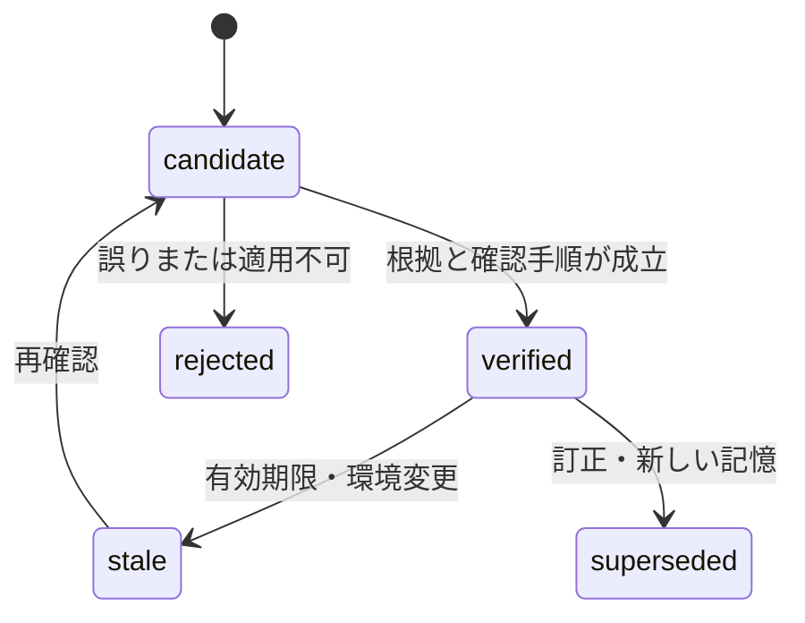

# 全体設計

状態：提案。以下のコンポーネント名とインターフェースは実装予定であり、動作するコマンドではない。

## 目的と境界

既存エージェントの作業能力を、経験の再利用によって改善する。ハーネスは記録・整理・検索・評価・版管理を担当し、基盤モデルや既存エージェントのタスク実行ループは差し替えない。

初期対象は論文整理の一つの作業系列。複数のエージェントが同じ記憶を共有する前に、単一エージェントで費用を含めた効果を測る。重み更新、外部OSSへの自動PR、コンペ提出、ホストへの常駐処理は初期範囲に含めない。

## コンポーネント

| 構成要素 | 入力 | 出力／責務 |
|---|---|---|
| Capture adapter | タスク、ツールの観測結果、ユーザー訂正 | 正規化イベント。権限や秘密を含む原文は公開しない |
| Evidence store | 正規化イベント、元ファイルの識別情報 | 追記型ログと内容ハッシュ。訂正も新イベントとして残す |
| Candidate extractor | 新規イベントの固定スナップショット | 再利用価値のある候補、適用範囲、根拠、未確認点 |
| Consolidator | 候補＋現在の記憶 | 重複統合、矛盾検出、訂正、失効の差分 |
| Verifier | 候補と根拠、独立した検証手順 | confirmed／pending／rejected。自己生成だけで確認済みにしない |
| Retriever | タスクのproject・task_family、固定記憶版 | 関連する記憶と根拠を上限内で返す |
| Evaluator | 固定課題、構成、モデル、記憶版 | 成功・訂正・再発・時間・費用、失敗理由 |
| Snapshot manager | 検証済み候補、評価報告 | 採用版、親版、内容ハッシュ、見送り理由、ロールバック先 |

最初はローカルJSON／JSONLとMarkdownを使う。ベクトルDB、グラフDB、専用クラウド基盤は必須にしない。原ログ検索もまずキーワード検索から比較する。

## 一回のsleep

1. 対象projectと入力ログの範囲・上限を確定し、snapshotとrun_idを作る。
2. 既処理event_idを除外する。元ログは書き換えない。
3. 成功、失敗、訂正から候補を抽出する。再利用価値がないものは理由付きで見送る。
4. 根拠の所在・内容ハッシュ・時点・適用範囲を確かめる。
5. 現行記憶と照合する。矛盾する項目は一方を黙って削除せず、関係と根拠を残す。
6. 必要な再現や事実確認を行い、未確認はcandidateのままにする。練習問題を生成しても、それ自体を事実の根拠にはしない。
7. candidate snapshotで評価し、採用条件を判定する。
8. 採用時だけactive参照を更新する。更新は親ハッシュが一致するときの単一書き込みとする。
9. 作成・確認・評価・公開それぞれの費用と結果を記録する。

同じ入力snapshotと設定の組は重複実行を識別する。LLM出力の再現性は保証できないため、再実行する場合は別run_idと出力を残す。

## 記憶の状態



verifiedは「記載した範囲で根拠を確認した」という状態。新タスクでの有効性や性能向上は別途評価する。verified項目でもactive snapshotへ採用されなければ通常の取得対象にならない。

ユーザーの明示的な好みと、実行結果から確認した手順、未確認の仮説をkindで分ける。現時点の作業状態や残高など、毎回取得できる変動情報は長期記憶へ安易に移さない。

## 次回の作業での取得

task_familyとprojectを先に絞り、active版のverified項目だけを通常検索する。初期の注入上限は2,000トークン。上限はモデルのトークナイザーで計測する実装を予定し、超過時は低関連項目から除外する。毎回全wikiを読み込まない。

取得内容は根拠付きの参考データとして渡す。現在のユーザー指示・対象リポジトリの方針・実行権限の方が優先される。候補や古い記憶を見る場合は、通常利用と区別した調査モードに限定する。

## 保存と公開の分離

```text
ローカル／非公開の実行保存先（この公開repoの外）
  events/                 原証拠・訂正イベント
  candidates/<run_id>/    記憶候補と差分
  snapshots/<hash>/       不変の記憶版
  evaluations/<run_id>/   実行結果・費用
  active.json             採用版の参照

公開repo
  docs/ schemas/ configs/ prompts/ templates/
  examples/               合成例だけ
  reports/                公開可能と確認した報告だけ（初期版では未作成）
```

GitHubには実行保存先を自動同期しない。公開対象を明示した一覧から差分を作り、秘密情報・私的な記憶・原ログの混入を確認する。.gitignoreは補助であり、公開可否を保証する仕組みではない。

## GitHub上の流れ

設計変更と公開用レポートはbranch → PR → 差分確認 → mergeで管理する。記憶snapshotの採用と公開repoへのmergeは別の操作。mergeしただけで既存エージェントの記憶や権限を変更しない。

既存の実験環境への導入は対象repoの方針に従う。特にOSS contributorのdraft-only、Gemmaのオフライン条件はこのハーネスから変更しない。必要なら対象側の別PRでadapterを追加する。

## 障害・矛盾・並行実行

- 原証拠にアクセスできない候補はcandidateのまま保留する。
- 費用／時間／トークン上限で止まったrunはincompleteと記録し、active版を更新しない。
- 一つのprojectのactive更新はsingle writer。親ハッシュ不一致なら再読み込みして再評価する。
- 書き込みは一時ファイルからのatomic replaceを想定する。異常終了後も直前のactive版を使用できるようにする。
- 悪化した場合はactive参照を親snapshotへ戻し、評価結果と失敗原因を残す。
- 記憶を削除する必要がある場合は、派生ノート・索引・snapshotへの参照も追跡して処理する。公開Git履歴を原ログの保存先にしない。

## 実装面の選択

既存エージェントへadapterを加える方式を優先する。最初から全エージェントを新ランタイムへ移さない。単独の永続エージェントアプリを追加する段階では、eveなどのランタイムを別ADRで検討する。現時点で新ランタイムの導入、依存パッケージ、API接続は行っていない。
