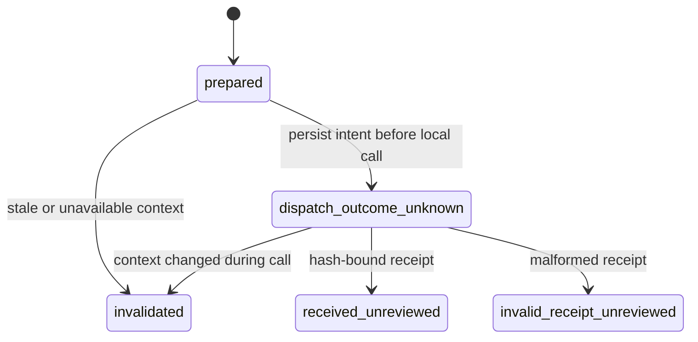

# Reference dispatch journal

**English** | [日本語](reference-use.ja.md) | [OSS bridge](oss-bridge.md)

## What is recorded

`ReferenceUseJournal` freezes one bounded task and one exact scoped reference
bundle, with the caller's consumer ID/version, target repository/agent commit,
retrieval query and byte/record caps. It stores task/reference hashes and actual
bytes in a **private separate SQLite journal**. Do not commit journals or outputs.

It makes at most one call to an explicitly supplied trusted local callable per
use ID. It does not load plugins, authenticate a consumer, create a model client,
send messages or add a scheduler. The caller must already have authority for any
actions performed by its consumer; task/memory text never grants that authority.

## State machine



An exception, process death or lost acknowledgment remains
`dispatch_outcome_unknown`. Reopening, preparing again or dispatching again never
calls that consumer a second time. No timeout resets, recovery replays or refunds
exist. A unique use ID and SQLite compare-and-swap prevent duplicate local
dispatch across journal connections. There is no transaction spanning arbitrary
consumer side effects and SQLite, so exactly-once completion is NOT claimed.

## Explicit local use

```python
from agent_sleep_lab.provenance import sha256_hex
from agent_sleep_lab.reference_use import ReferenceUseJournal

def offline_consumer(*, use_id, task_bytes, reference_bytes):
    # Explicit trusted fixture code; replace only with an already-authorized
    # consumer, preserving its policy and separate reference-data channel.
    output = b"synthetic offline output"
    return {
        "use_id": use_id,
        "task_sha256": sha256_hex(task_bytes),
        "reference_sha256": sha256_hex(reference_bytes),
        "output_bytes": output,
    }

journal = ReferenceUseJournal(private_journal_path)
try:
    journal.prepare(
        "use-1", bridge, task_bytes=b"synthetic task", query="duplicate",
        max_bytes=16384, consumer_id="offline-fixture", consumer_version="1",
    )
    result = journal.dispatch(
        "use-1", bridge, offline_consumer,
        consumer_id="offline-fixture", consumer_version="1",
    )
finally:
    journal.close()
```

The bridge/store must already be configured. Tasks are 1–65,536 bytes, references
at most 262,144 bytes (whole serialized bundle), consumer output at most 65,536
bytes. These are post-return output validation bounds, not a sandbox, time,
memory, token or spending ceiling on the consumer.

## Current context and trust

Before dispatch, re-retrieve under current policy and compare the frozen context.
Ignore only the read timestamp `as_of`; policy, snapshot, records, exclusions,
scope and budgets remain part of the comparison. Check again after return.
If changed, preserve a valid returned output but mark the use invalidated.
An unavailable recheck also fails closed.

These checks do not eliminate the race between the precheck and consumer action.
The consumer must enforce current policy at its own action boundary when needed.
The journal never rewrites the agent's ledger, permissions, adoption or scores.

A correctly hash-bound receipt is **unreviewed consumer self-report**, not proof
that memory affected reasoning or improved task quality. Status always includes
`delivery_and_use_verified=False`. No result is automatically evidence,
verification, evaluation, adoption, or a completed existing-agent integration.
An independent actual-agent invocation and delivery/use review remain necessary.
The source bridge remains synthetic-only; do not relabel real logs.

## Verification

The synthetic regression suite checks reopen/repeat behavior, unknown outcomes,
stopped-worker intents, pre/post policy changes, wrong receipts, conflicting
identities, concurrent dispatch, foreign-database refusal and binding corruption.
See [current verification](implementation-status.md) for executed results.
